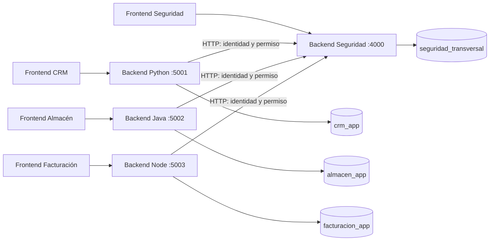

# Arquitectura de las cuatro aplicaciones

## Separación real



Son cuatro bases lógicas en la misma instancia PostgreSQL 17. Cada una tiene un propietario de instalación y un usuario de ejecución sin permisos para conectar a las otras tres. No se crean cuatro servidores PostgreSQL.

| App         | Base                    | Propietario         | Ejecución             |
| ----------- | ----------------------- | ------------------- | --------------------- |
| Seguridad   | `seguridad_transversal` | `st_owner`          | `st_app`              |
| CRM         | `crm_app`               | `crm_owner`         | `crm_runtime`         |
| Almacén     | `almacen_app`           | `almacen_owner`     | `almacen_runtime`     |
| Facturación | `facturacion_app`       | `facturacion_owner` | `facturacion_runtime` |

El instalador revoca `CONNECT` y `TEMPORARY` de PUBLIC solo en estas cuatro bases y concede CONNECT a sus dos roles respectivos. No cambia otras bases del equipo, ni contraseñas de roles existentes. Un superusuario PostgreSQL conserva sus privilegios administrativos.

## Recorrido de una petición

1. El navegador inicia sesión contra el backend de su propia app.
2. Ese backend envía correo/contraseña y su credencial de aplicación a IAM.
3. IAM aplica MFA según la política del usuario y permite seleccionar el rol cuando hay varios.
4. La sesión queda en una cookie HttpOnly del cliente y en la base central como hash. El navegador no recibe la credencial de integración.
5. Al abrir una pantalla, el backend solicita `auth/introspect` con el código del permiso.
6. Si IAM deniega, termina la petición sin escribir datos en la base local.
7. Si IAM autoriza, el backend utiliza su conexión propia y registra una fila en `integration_access`.

8. Dentro de la pantalla, cada operación sobre sus registros pide a IAM una capacidad propia (`<pantalla>.ver`, `.crear`, `.editar`, `.eliminar`, `.exportar`). El frontend usa la lista de capacidades de `/me` para mostrar u ocultar la grilla, los botones y las columnas; el backend la comprueba de nuevo antes de tocar su tabla `records`.

## Modelo de autorización

```text
Rol ──< role_menus >── Menú (pantalla, dentro de una familia/grupo)
 │                        │
 └──< role_capabilities >─┴─< Capacidad: grid | button | column
```

- **Menú**: concede la entrada a la pantalla y su aparición en la navegación. Los grupos (familias) se muestran solo si contienen pantallas autorizadas.
- **Capacidad**: grilla, botón o columna de una pantalla. Solo es efectiva si el rol conserva la pantalla y el elemento está activo. Su código empieza por el de la pantalla (`crm.clientes.crear`).
- Ambas tablas están en `seguridad_transversal`. Las bases de negocio no guardan roles ni permisos.

Cada demo guarda sus registros en una tabla local `records` (`module` = código de pantalla, `data` = columnas declaradas en `backend/app.json`). Es deliberadamente genérica: mantiene sencillas las tres aplicaciones y permite que los tres backends (Python, Java y Node) apliquen el mismo contrato. `integration_access` sigue registrando cada entrada autorizada a una pantalla.

`GET /api/v1/integration/status` está protegido por la sesión central y devuelve la base y usuario SQL observados por el propio backend, más el número de accesos del usuario actual. Sirve para demostrar la integración mediante API; no se muestra en las pantallas.

## Frontends independientes

Cada carpeta `frontend` tiene `package.json`, `vite.config.js`, `src/main.jsx`, componentes, estilos y `dist` propios. Las demos tienen `src/pages/index.jsx` para comenzar a implementar sus pantallas. Cambiar CRM no recompila ni cambia Almacén o Facturación, salvo que se ejecute voluntariamente el comando global de compilación.

La independencia es visible: cada demo tiene su propia identidad. CRM y Almacén comparten la estructura de barra lateral (`Demo.jsx`, `demo.css`) y se diferencian con su `theme.css`; Facturación tiene un `Demo.jsx` y un `demo.css` distintos, con navegación superior. El inicio de sesión (`Auth.jsx`) conserva el mismo flujo en todas y se rediseña por app solo con CSS, bajo la clase `demo-<app>`. Lo único común es el contrato: menús y `capabilities` que entrega IAM, y la cabecera con el usuario y su rol activo.

El workspace de pnpm comparte la instalación de dependencias y el lockfile, no las fuentes ni el estado de ejecución. Un cambio de dependencias actualiza el lockfile raíz y debe coordinarse entre chats.

## Configuración independiente

- `.env` raíz: parámetros de la cuenta administrativa de PostgreSQL, solo para instalación.
- `apps/app-*/backend/.env`: conexión a su base, conexión de migración y configuración privada de esa app.
- Demos: `CORE_URL`, `APP_ID` y `APP_KEY` apuntan a la integración HTTP con IAM.
- Seguridad: claves de firma/cifrado y configuración corporativa; no tiene conexiones a bases de negocio.
- `backend/app.json` de cada demo: catálogo de pantallas existentes, sus acciones, columnas (con las protegidas) y códigos de autorización, sin secretos.

El coordinador `db:seed` prepara las apps iniciales en IAM y configura el identificador/clave en los tres `.env` locales. Es una herramienta de instalación; los runtimes no comparten archivos de secretos ni leen carpetas de otras apps.

No hay usuarios SQL compartidos, consultas entre bases, replicación de contraseñas ni SSO. Una baja de usuario o una revocación central se aplica a la siguiente petición protegida de cualquiera de las aplicaciones.
