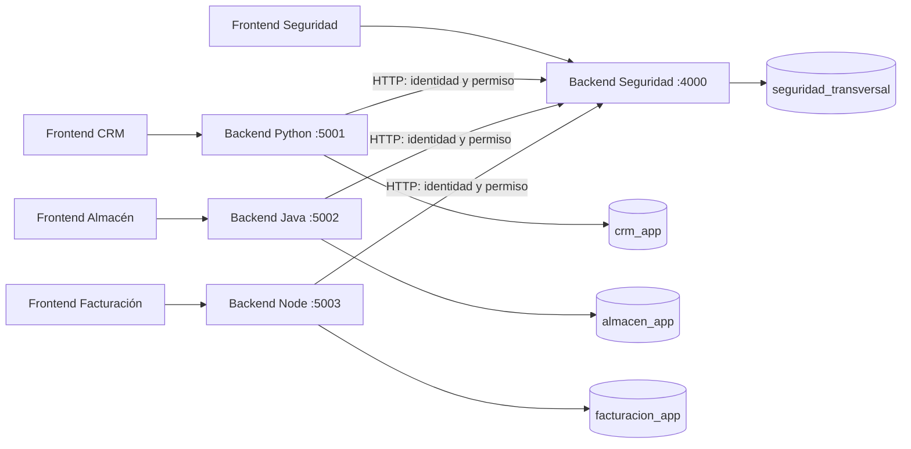

# Arquitectura de las cuatro aplicaciones

## Separación real

Son cuatro bases lógicas en la misma instancia PostgreSQL 17. Cada una tiene un propietario de instalación y un usuario de ejecución sin permisos para conectar a las otras tres. No se crean cuatro servidores PostgreSQL.

| App         | Base                    | Propietario         | Ejecución             |
| ----------- | ----------------------- | ------------------- | --------------------- |
| Seguridad   | `seguridad_transversal` | `st_owner`          | `st_app`              |
| CRM         | `crm_app`               | `crm_owner`         | `crm_runtime`         |
| Almacén     | `almacen_app`           | `almacen_owner`     | `almacen_runtime`     |
| Facturación | `facturacion_app`       | `facturacion_owner` | `facturacion_runtime` |

El instalador revoca `CONNECT` y `TEMPORARY` de PUBLIC solo en estas cuatro bases y concede CONNECT a sus dos roles respectivos. No cambia otras bases del equipo, ni contraseñas de roles existentes. Un superusuario PostgreSQL conserva sus privilegios administrativos.

## Recorrido de una petición

1. El navegador inicia sesión contra el backend de su propia app.
2. Ese backend envía correo/contraseña y su credencial de aplicación a IAM.
3. IAM aplica MFA según la política del usuario y permite seleccionar el rol cuando hay varios.
4. La sesión queda en una cookie HttpOnly del cliente y en la base central como hash. El navegador no recibe la credencial de integración.
5. Al abrir una pantalla, el backend solicita `auth/introspect` con el código del permiso.
6. Si IAM deniega, termina la petición sin escribir datos en la base local.
7. Si IAM autoriza, el backend utiliza su conexión propia y registra una fila en `integration_access`.

Las páginas siguen vacías, como se pidió. El registro mínimo local permite comprobar con SQL que las apps sí operan en bases distintas y deja un lugar para agregar los módulos de negocio.

`GET /api/v1/integration/status` está protegido por la sesión central y devuelve la base y usuario SQL observados por el propio backend, más el número de accesos del usuario actual. Sirve para demostrar la integración mediante API; no se muestra en las pantallas.

## Frontends independientes

Cada carpeta `frontend` tiene `package.json`, `vite.config.js`, `src/main.jsx`, componentes, estilos y `dist` propios. Las demos tienen `src/pages/index.jsx` para comenzar a implementar sus pantallas. Cambiar CRM no recompila ni cambia Almacén o Facturación, salvo que se ejecute voluntariamente el comando global de compilación.

El npm workspace comparte la instalación de dependencias y el lockfile, no las fuentes ni el estado de ejecución. Un cambio de dependencias actualiza el lockfile raíz y debe coordinarse entre chats.

## Configuración independiente

- `.env` raíz: parámetros de la cuenta administrativa de PostgreSQL, solo para instalación.
- `apps/app-*/backend/.env`: conexión a su base, conexión de migración y configuración privada de esa app.
- Demos: `CORE_URL`, `APP_ID` y `APP_KEY` apuntan a la integración HTTP con IAM.
- Seguridad: claves de firma/cifrado y configuración corporativa; no tiene conexiones a bases de negocio.
- `backend/app.json` de cada demo: catálogo de pantallas existentes y códigos de autorización, sin secretos.

El coordinador `db:seed` prepara las apps iniciales en IAM y configura el identificador/clave en los tres `.env` locales. Es una herramienta de instalación; los runtimes no comparten archivos de secretos ni leen carpetas de otras apps.

No hay usuarios SQL compartidos, consultas entre bases, replicación de contraseñas ni SSO. Una baja de usuario o una revocación central se aplica a la siguiente petición protegida de cualquiera de las aplicaciones.
